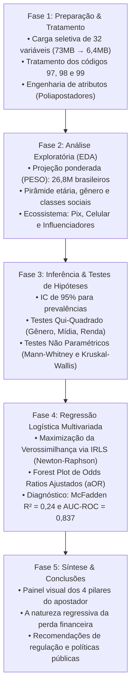

# O Perfil do Apostador Brasileiro: Uma Análise Estatística dos Microdados da TIC Domicílios 2025

> **Projeto Final de Probabilidade e Estatística**  
> **Base de Dados:** Microdados Oficiais da Pesquisa TIC Domicílios 2025 — Cetic.br / NIC.br  
> **Notebook Principal:** [`projeto_apostas_digitais.ipynb`](projeto_apostas_digitais.ipynb)  
> **Base Processada:** [`tic_domicilios_processada_apostas.csv`](tic_domicilios_processada_apostas.csv)

---

## Sumário Executivo

Nos últimos anos, o Brasil experimentou uma rápida e agressiva expansão do ecossistema de apostas online (*bets* esportivas, cassinos virtuais como o *Jogo do Tigrinho*, rifas digitais em redes sociais e loterias eletrônicas). A edição de **2025 da pesquisa TIC Domicílios**, conduzida pelo Centro Regional de Estudos para o Desenvolvimento da Sociedade da Informação (**Cetic.br**), incorporou de maneira pioneira um bloco investigativo dedicado a mensurar a prática de apostas digitais no Brasil (**Módulo C14**).

Este projeto analisa os microdados dessa pesquisa sob rigor metodológico em **Probabilidade, Inferência Estatística e Modelagem Multivariada**, estruturando-se em **5 Fases sequenciais**:

1. **Fase 1: Preparação, Limpeza e Pré-processamento dos Dados**
2. **Fase 2: Análise Exploratória de Dados (EDA) e Visualização**
3. **Fase 3: Inferência Estatística e Testes de Hipóteses**
4. **Fase 4: Modelagem Multivariada (Regressão Logística Binária via Máxima Verossimilhança)**
5. **Fase 5: Síntese, Discussão e Conclusões Estatísticas**

---

## Estrutura do Projeto: Passo a Passo



---

### Fase 1: Preparação, Limpeza e Pré-processamento dos Dados

#### O que foi feito:
* **Leitura Otimizada:** O arquivo original continha mais de 24 mil respondentes e centenas de colunas (~73 MB). Foi realizada a seleção de **32 variáveis estratégicas** (apostas, dados sociodemográficos, variáveis econômicas e comportamento digital), reduzindo o uso de memória e gravando uma base tratada de 6,4 MB.
* **Tratamento de Códigos Sentinela:**
  * Códigos `97` (Não sabe) e `98` (Não respondeu) foram convertidos em `NaN`.
  * O código `99` (Não se aplica — indivíduos que não usaram a internet nos últimos 3 meses) nas variáveis de aposta foi imputado logicamente como `0` (Não apostou no universo populacional geral).
* **Decodificação Categórica Oficial:** Mapeamento segundo o Dicionário da TIC Domicílios 2025 para variáveis como `sexo_desc`, `faixa_etaria_desc`, `classe_desc` (Critério Brasil 2015), `escolaridade_desc`, `regiao_desc` e `tipo_ocupacao_desc`.
* **Engenharia de Atributos (*Feature Engineering*):**
  * `qtd_modalidades`: Soma de modalidades praticadas pelo indivíduo (0 a 4).
  * `poliapostador`: Indicador binário para quem aposta em **2 ou mais** modalidades diferentes.
  * `status_aposta`: Rótulo analítico (*Apostador* vs *Não Apostador*).

#### O que foi encontrado:
* Amostra total: **24.535 indivíduos entrevistados**.
* Apostadores identificados na amostra bruta: **3.836 indivíduos (15,63%)**.
* Indivíduos classificados como *Poliapostadores*: **1.468 indivíduos (5,98% da amostra)**.

---

### Fase 2: Análise Exploratória de Dados (EDA) e Visualizações

#### O que foi feito:
* **Estimativa Amostral vs Estimativa Ponderada:** Aplicação dos pesos amostrais (`PESO`) para projetar a proporção real para os ~185 milhões de brasileiros com 10 anos ou mais:
  $$\hat{P} = \frac{\sum_{i=1}^n w_i \cdot Y_i}{\sum_{i=1}^n w_i}$$
* **Perfil Demográfico:** Análise bivariada de gênero, curva de densidade contínua de idades (KDE) e boxplots para cada modalidade.
* **Perfil Socioeconômico e Geográfico:** Cruzamento por classes sociais (A, B, C, DE), grau de escolaridade, trabalho formal vs informal e macrorregiões brasileiras.
* **O Ecossistema Tecnológico:** Investigação da penetração de apostas segundo o uso de Pix, tipo de dispositivo (*mobile-only* vs PC) e consumo de vídeos de influenciadores e de esportes.
* **Matriz de Correlação:** Correlação linear entre as 4 modalidades de aposta.

#### O que foi encontrado:
* **Prevalência Populacional Ponderada:** **14,47% dos brasileiros** apostam online (~26,8 milhões de pessoas).
* **Ranking das Modalidades na População:**
  1. **Cassino Online (*Tigrinho*):** 6,89% (~12,8 milhões de brasileiros)
  2. **Rifas Digitais / Sorteios em Redes:** 5,81% (~10,8 milhões)
  3. **Apostas Esportivas (*Bets*):** 5,30% (~9,8 milhões)
  4. **Loteria Federal Online:** 4,47% (~8,3 milhões)
* **Assimetria Geracional:** A mediana de idade dos apostadores é de **33 anos**, contra **47 anos** dos não apostadores.
* **Segmentação por Gênero:** Homens aderem quase 3x mais às apostas esportivas (8,6% vs 2,8%). Por outro lado, as mulheres têm adesão massiva ao cassino online (7,3%) e às rifas digitais (6,7%).
* **Vetor dos Influenciadores:** Indivíduos que assistem habitualmente a vídeos de influenciadores têm adesão de **11,6%** ao Tigrinho, contra apenas **4,5%** entre os que não assistem (Razão de Prevalência de **2,58x**).

---

### Fase 3: Inferência Estatística e Testes de Hipóteses

#### O que foi feito:
Formulação formal de hipóteses ($H_0$ vs $H_1$) com nível de significância de $\alpha = 0,05$, cálculo de intervalos de confiança e estatísticas de teste:

| Teste Estatístico | Pergunta / Hipótese | Estatística Calculada | Valor-$p$ | Decisão ($\alpha=5\%$) | Tamanho do Efeito |
| :--- | :--- | :---: | :---: | :---: | :---: |
| **Intervalos de Confiança (95%)** | Prevalência populacional de apostas | Erro Padrão Amostral | — | Estimativa pontual $\pm 0,45\%$ | IC 95%: $[15,18\% \ ; \ 16,09\%]$ |
| **Qui-Quadrado ($\chi^2$)** | Gênero vs Modalidade de Jogo (Bets vs Cassino) | $\chi^2 = 296,87$ ($df=2$) | $3,42 \times 10^{-65}$ | **Rejeita $H_0$** | $V \text{ de Cramér} = 0,334$ (moderado-alto) |
| **Qui-Quadrado e Odds Ratio** | Influenciadores vs Cassino Online (*Tigrinho*) | $\chi^2 = 385,82$ ($df=1$) | $6,70 \times 10^{-86}$ | **Rejeita $H_0$** | **$OR = 2,80$** (IC 95%: $[2,51 \ ; \ 3,12]$) |
| **Homogeneidade ($\chi^2$)** | Classes Sociais vs Prática de Apostas | $\chi^2 = 70,55$ ($df=3$) | $3,25 \times 10^{-15}$ | **Rejeita $H_0$** | Resíduos de Haberman: DE ($z=-7,5$), C ($z=+4,4$), B ($z=+3,4$) |
| **Mann-Whitney U** | Distribuição de Idades: Apostador vs Não Apostador | $U = 2,57 \times 10^7$ ($Z = -34,79$) | $< 10^{-260}$ | **Rejeita $H_0$** | $r \text{ de Rosenthal} = 0,222$ |
| **Kruskal-Wallis** | Idade entre as 4 Modalidades de Aposta | $H = 143,62$ ($df=3$) | $6,24 \times 10^{-31}$ | **Rejeita $H_0$** | Pós-teste Bonferroni: Loteria ($40$a) é mais velha que Cassino ($30$a) e Bets ($31$a) |

---

### Fase 4: Modelagem Multivariada (Regressão Logística Binária)

#### O que foi feito:
Para eliminar o viés de confundimento (*confounding*), formulamos um modelo probabilístico multivariado na escala logit:

$$\text{logit}(P(Y=1 \mid \mathbf{X})) = \beta_0 + \sum_{j=1}^k \beta_j X_j$$

* **Otimização Numérica:** O modelo foi ajustado via **Máxima Verossimilhança** utilizando o algoritmo **IRLS (*Iteratively Reweighted Least Squares* / Newton-Raphson)**, convergindo em **7 iterações** com tolerância de $2,16 \times 10^{-10}$.
* **Inferência dos Parâmetros:** Erros padrão obtidos através da inversa da Informação de Fisher $\mathcal{I}(\boldsymbol{\beta}) = (\mathbf{X}^T \mathbf{W} \mathbf{X})^{-1}$.
* **Diagnóstico de Ajuste:** Pseudo-$R^2$ de McFadden, Teste de Razão de Verossimilhança (LRT), Curva ROC analítica e Matriz de Confusão com limiar ótimo.

#### Resultados dos Coeficientes e Odds Ratios Ajustados (aOR):

```
                                Forest Plot das Razões de Chance (aOR)
Uso de Pix (C8_I)          |=========================================> 9.46x [8.16 - 10.97]
Joga Games Online          |============> 3.03x [2.78 - 3.30]
Vídeos de Esporte          |=====> 1.62x [1.48 - 1.78]
Gênero Masculino           |====> 1.57x [1.45 - 1.71]
Acesso Exclusivo Celular   |===> 1.39x [1.26 - 1.53]
Influenciadores Digitais   |===> 1.36x [1.24 - 1.49]
Ensino Médio               |==> 1.30x [1.18 - 1.44]
Ensino Superior            |=> 1.21x [1.05 - 1.39]
Trabalho Informal          | 1.09x [1.00 - 1.18] (p = 0.054)
Classes A, B, C            | 0.92x - 1.05x [Não significantes, p > 0.25]
                           +-----------------------------------------
                          1.0 (Efeito Nulo)
```

#### Performance do Modelo:
* **Pseudo-$R^2$ de McFadden:** **$0,2416$** (Ajuste considerado excelente pela literatura econométrica).
* **Área sob a Curva ROC (AUC-ROC):** **$0,8373$** (Excelente capacidade de discriminação).
* **Sensibilidade (*Recall*):** **$77,84\%$** | **Especificidade:** **$74,21\%$** | **Acurácia Geral:** **$74,78\%$**.

---

### Fase 5: Síntese, Discussão e Conclusões

#### O que foi feito:
* Construção de um **painel visual integrado com os 4 pilares analíticos do estudo**.
* Discussão profunda conectando a economia comportamental, os mecanismos de pagamento e as teorias de atrito (*frictionless finance*).
* Sistematização das limitações metodológicas e recomendações regulatórias.

---

## Curiosidades e Fatos Contraintuitivos Revelados pelos Dados

1. **O "Tigrinho" superou as Bets Esportivas no Brasil:**
   Embora o futebol e os campeonatos esportivos concentrem a maior visibilidade em patrocínios de camisa e comerciais de TV, **o Cassino Online (*Tigrinho*) tem significativamente mais jogadores no Brasil** (~12,8 milhões) do que as Apostas Esportivas (~9,8 milhões).
2. **A Feminilização do Cassino e das Rifas:**
   Enquanto as apostas esportivas são predominantemente um fenômeno masculino (quase 3 para 1), o público feminino aderiu em massa aos cassinos eletrônicos (**7,3% das mulheres brasileiras jogam**) e às rifas digitais (**6,7%**).
3. **A Renda em Si Não Determina Quem Aposta:**
   Ao controlar simultaneamente por smartphone, Pix, escolaridade e idade, **as classes sociais (A, B, C, DE) não apresentam diferença estatística significante ($p > 0,25$)**. Ricos, classe média e trabalhadores de baixa renda com o mesmo nível de inclusão digital apostam na mesma proporção. A aposta não é impulsionada pela carência financeira em si, mas pela **exposição midiática e facilidade de pagamento**.
4. **O Pix é o Grande Alavancador Comportamental:**
   O uso habitual de Pix multiplica a chance de apostar por **$9,46$ vezes** ($aOR = 9,46$). A eliminação do tempo de espera entre a decisão impulsiva e o aporte financeiro derrubou as barreiras psicológicas de autocontrole.
5. **A Ponte entre o Videogame e a Aposta Financeira:**
   Quem tem o hábito de jogar games eletrônicos online possui **$3,03$ vezes mais chances** de fazer apostas financeiras ($p < 10^{-130}$). Elementos visuais lúdicos, recompensas intermitentes e sons de vitória transformaram a fronteira entre *jogar por diversão* e *apostar dinheiro real* em algo imperceptível.
6. **Quase Metade dos Apostadores de Bets Migram para o Cassino:**
   Entre os indivíduos que apostam em esportes, **$44,9\%$ também apostam no cassino online**, comprovando a eficácia das estratégias de *cross-selling* das plataformas de apostas.

---

## Conclusões Substantivas

1. **A Natureza Regressiva do Fenômeno:**
   Embora a *propensão percentual* a apostar seja transversal a todas as classes sociais, o **impacto econômico é brutalmente regressivo**. Despender R$ 100 mensais em apostas é irrelevante para uma família da Classe A, mas compromete mais de $10\%$ do orçamento básico de uma família de baixa renda, drenando recursos destinados à alimentação, saúde e consumo no comércio local.
2. **Urgência Regulatória e Proteção ao Consumidor:**
   A evidência empírica de que influenciadores digitais elevam em quase 3 vezes a probabilidade de adesão a cassinos online justifica intervenções regulatórias rigorosas sobre a publicidade enganosa de "renda extra", transparência das taxas de retorno (RTP) e proibição de marketing direcionado a menores de 18 anos.
3. **Mecanismos de Autocontrole Financeiro:**
   Dada a forte associação com o Pix, ferramentas que reintroduzam atrito (como limites diários de depósitos em plataformas de apostas e atrasos propositais em transações noturnas) são imperativas para atenuar o risco de superendividamento.

---

## Como Executar o Projeto

### Pré-requisitos
* Python 3.10 ou superior
* Bibliotecas: `pandas`, `numpy`, `matplotlib`, `seaborn`, `scipy`

### Execução Local
1. Clone ou acesse o diretório do projeto:
   ```bash
   cd "Aulas/Probabilidade e Estatistisca/Projeto Final"
   ```
2. Ative o ambiente virtual:
   ```bash
   source .venv/bin/activate
   ```
3. Abra o Jupyter Notebook:
   ```bash
   jupyter notebook projeto_apostas_digitais.ipynb
   ```
*O notebook já se encontra totalmente executado com todas as saídas de texto, tabelas formatadas e os 10 gráficos de alta resolução salvos nas células.*

---

## Referências e Fontes dos Dados
* **Cetic.br / NIC.br:** Pesquisa sobre o Uso das Tecnologias de Informação e Comunicação nos Domicílios Brasileiros — *TIC Domicílios 2025* (Microdados de Indivíduos).
* **ABEP:** Critério de Classificação Econômica Brasil (Critério Brasil 2015).
* **Kahneman, D. & Tversky, A.:** *Prospect Theory: An Analysis of Decision under Risk*. Econometrica, 1979.
* **Agresti, A.:** *Categorical Data Analysis*. Wiley, 3rd Edition, 2013.
