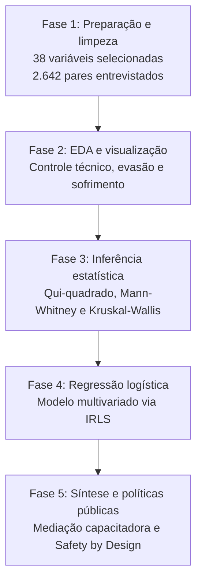

# A Ilusão do Controle Parental: Riscos Digitais e Saúde Mental na Infância

> **Projeto Final de Probabilidade e Estatística**  
> **Base de dados:** Microdados oficiais da pesquisa TIC Kids Online Brasil 2025 — Cetic.br / NIC.br  
> **Notebook principal:** [`projeto_tic_kids_mediacao_parental.ipynb`](projeto_tic_kids_mediacao_parental.ipynb)  
> **Base processada:** [`tic_kids/tic_kids_processada.csv`](tic_kids/tic_kids_processada.csv)

## Sumário executivo

Este projeto investiga se filtros, bloqueadores, monitoramento de aplicativos e outras ferramentas de controle técnico realmente protegem crianças e adolescentes contra riscos digitais e sofrimento emocional.

A pesquisa TIC Kids Online Brasil 2025 entrevista pares formados por uma criança ou adolescente, entre 9 e 17 anos, e seu respectivo responsável. Esse desenho permite comparar o que os pais acreditam controlar com o que os filhos vivenciam e conseguem relatar sobre sua vida online.

### Pergunta central

> Crianças cujos pais utilizam mais ferramentas técnicas de controle sofrem menos incômodo emocional na internet?

O resultado principal é que o controle técnico isolado não apresentou efeito protetivo estatisticamente significativo. A proteção digital depende também de diálogo, acolhimento, letramento digital e mecanismos de segurança incorporados às próprias plataformas.

## Estrutura do estudo



## Fase 1: Preparação, limpeza e pré-processamento

Foram selecionadas **38 variáveis centrais** dos blocos da criança e do responsável, abrangendo:

- perfil demográfico e socioeconômico;
- ferramentas técnicas de mediação parental (`GK1_A` a `GK1_G`);
- percepção da criança sobre o conhecimento dos pais (`U1`);
- práticas de supervisão e participação parental (`U5_A` a `U5_G`);
- evasão de filtros e controles (`T26C_F`);
- exposição a conteúdos sensíveis e desfechos emocionais.

Os códigos sentinela foram tratados conforme a metodologia da pesquisa:

- `97`: não sabe;
- `98`: não respondeu ou recusou;
- `99`: não se aplica.

Foram criados os seguintes indicadores analíticos:

1. **`score_controle_tecnico`**, de 0 a 7, somando os recursos técnicos utilizados pelos responsáveis;
2. **`alto_controle_tecnico`**, para famílias que utilizam pelo menos três ferramentas;
3. **`incomodo_emocional_recorrente`**, variável resposta baseada na frequência de incômodo na internet;
4. **`busca_sofrimento_emocional`**, indicando pesquisa sobre sentimentos, saúde mental ou sofrimento;
5. **`burlou_controle_pais`**, indicando que a criança já desativou filtros ou controles;
6. **`supervisao_invasiva`**, associada à fiscalização frequente do celular.

### Auditoria inicial

- **2.642** pares criança-responsável entrevistados;
- **53** atributos após a engenharia de variáveis;
- média de idade das crianças: **12,9 anos**;
- média do score de controle técnico: **2,04 ferramentas**;
- incômodo emocional recorrente na amostra válida: **53,8%**;
- crianças que já burlaram controles dos pais: **22,43%**.

A base processada é exportada para [`tic_kids/tic_kids_processada.csv`](tic_kids/tic_kids_processada.csv).

## Fase 2: Análise exploratória e visualização

A análise exploratória investigou o arsenal de ferramentas técnicas, a percepção de segurança dos pais, a evasão dos filtros, o sofrimento emocional e as diferenças por gênero, idade e classe social.

### Principais achados

- **77,3%** dos pais acreditam que os filhos usam a internet com segurança;
- **42,6%** das crianças afirmam que os pais sabem pouco ou nada sobre o que fazem online;
- entre adolescentes de **15 a 17 anos**, a evasão de filtros chega a **28,9%**;
- o incômodo emocional foi semelhante entre crianças sem filtros (**52,6%**) e aquelas em lares com alto controle técnico (**54,6%**);
- a supervisão invasiva esteve associada a maior relato de incômodo emocional (**60,4%**, contra **49,6%** nos demais casos);
- meninas relataram maior busca por conteúdos relacionados a sofrimento emocional e saúde mental (**42,8%**, contra **28,6%** dos meninos).

Esses resultados sugerem que instalar ferramentas técnicas não elimina a exposição a conflitos, pressões sociais, assédio, comparação social ou conteúdos perturbadores. Em alguns casos, a fiscalização invasiva pode refletir ou intensificar conflitos familiares já existentes.

## Fase 3: Inferência estatística

Os testes foram conduzidos com nível de significância de **5%** (`α = 0,05`).

| Teste | Resultado | Interpretação |
| --- | ---: | --- |
| Controle técnico vs. incômodo emocional | `χ² = 0,3217`, `p = 0,5706` | Não há evidência de efeito protetivo do alto controle técnico. |
| Gênero vs. busca por sofrimento emocional | `OR = 2,2300`, `p = 1,3879 × 10⁻¹²` | Meninas têm mais que o dobro das chances de buscar esses conteúdos. |
| Escolaridade vs. alto controle técnico | `χ² = 63,6713`, `p = 1,4926 × 10⁻¹⁴` | A adoção de ferramentas varia conforme a escolaridade dos responsáveis. |
| Idade vs. evasão de filtros | `U = 266.660,50`, `p = 1,4018 × 10⁻¹⁰` | Crianças que burlaram controles são significativamente mais velhas. |
| Faixa etária vs. incômodo emocional | `H = 5,8968`, `p = 0,1167` | Não houve diferença estatisticamente significativa entre as faixas. |

O teste central da pesquisa não rejeitou a hipótese nula: a presença de três ou mais recursos técnicos não reduziu significativamente o incômodo emocional relatado pelas crianças.

## Fase 4: Regressão logística multivariada

Foi ajustado um modelo de regressão logística binária para estimar a probabilidade de `incomodo_emocional_recorrente`, controlando simultaneamente por idade, gênero, escolaridade, classe social, exposições de risco e práticas de mediação parental.

O modelo foi estimado por máxima verossimilhança usando **IRLS / Newton-Raphson**:

```text
Observações válidas: 2.370
Parâmetros estimados: 11
Convergência: iteração 4
Log-verossimilhança do modelo: -1613,20
Log-verossimilhança nula: -1635,92
Teste LRT: G² = 45,43; p = 1,8152 × 10⁻⁶
AUC-ROC: 0,5782
```

### Efeitos principais

- **Score de controle técnico:** `aOR = 1,01`, `p = 0,5308`, IC 95% `[0,98; 1,05]`. O efeito é estatisticamente indistinguível de zero.
- **Gênero feminino:** `aOR = 1,55`, `p = 2,14 × 10⁻⁷`. Meninas têm aproximadamente 55% mais chances de relatar incômodo emocional recorrente.
- **Classe AB:** `aOR = 0,72`, `p = 0,036`. Apresenta efeito protetivo em comparação com a classe DE.
- **Mediação dialógica:** `aOR = 1,18`, `p = 0,058`. O resultado é limítrofe e pode refletir maior abertura para verbalizar experiências negativas.

O modelo reforça a conclusão da análise bivariada: aumentar o número de ferramentas de controle não equivale a reduzir o sofrimento emocional na rede.

## Fase 5: Síntese e implicações

### Quatro pilares encontrados

1. **Ilusão do controle técnico:** filtros e bloqueadores podem criar sensação de segurança sem impedir experiências emocionais negativas.
2. **Evasão geracional:** adolescentes mais velhos conseguem neutralizar ou contornar os controles com maior frequência.
3. **Abismo de percepção:** a confiança dos responsáveis sobre a segurança dos filhos não coincide necessariamente com o conhecimento real sobre sua vida online.
4. **Vulnerabilidade de gênero:** meninas apresentam maior exposição a sofrimento emocional e maior busca por informações de saúde mental.

### Recomendações

- substituir o controle mecânico unilateral por **mediação capacitadora**, baseada em diálogo e negociação de limites;
- criar canais escolares permanentes de acolhimento emocional e letramento digital;
- evitar que a supervisão seja exclusivamente punitiva ou invasiva;
- responsabilizar plataformas pela adoção de **Safety by Design**, com proteção ativa para menores e redução da exposição a contatos e recomendações potencialmente nocivos.

## Limitações metodológicas

1. O delineamento é transversal e não permite estabelecer causalidade ou acompanhar trajetórias ao longo do tempo.
2. As respostas dos pais podem sofrer viés de desejabilidade social.
3. O incômodo emocional é uma medida subjetiva, baseada no relato da criança ou adolescente.
4. A análise observa associações estatísticas; portanto, os resultados não devem ser interpretados como prova de que uma prática parental isolada causa sofrimento ou proteção.

## Como executar

### Pré-requisitos

- Python 3.10 ou superior;
- Jupyter Notebook;
- `pandas`, `numpy`, `matplotlib`, `seaborn` e `scipy`.

### Execução

Na raiz do projeto:

```bash
source .venv/bin/activate
jupyter notebook controle_parental_digital/projeto_tic_kids_mediacao_parental.ipynb
```

O notebook localiza automaticamente a raiz do projeto e acessa os arquivos dentro de `controle_parental_digital/tic_kids/`.

## Arquivos do projeto

- [`projeto_tic_kids_mediacao_parental.ipynb`](projeto_tic_kids_mediacao_parental.ipynb): análise completa em cinco fases;
- [`tic_kids/tic_kids_online_brasil_2025_base_de_microdados_v1.0.csv`](tic_kids/tic_kids_online_brasil_2025_base_de_microdados_v1.0.csv): microdados da pesquisa;
- [`tic_kids/tic_kids_online_brasil_2025_dicionario_de_variaveis_v1.0.xlsx`](tic_kids/tic_kids_online_brasil_2025_dicionario_de_variaveis_v1.0.xlsx): dicionário oficial das variáveis;
- [`tic_kids/tic_kids_processada.csv`](tic_kids/tic_kids_processada.csv): base tratada e enriquecida.

## Referências

- **Cetic.br / NIC.br:** Pesquisa TIC Kids Online Brasil 2025 — microdados e dicionário de variáveis.
- **Agresti, A.:** *Categorical Data Analysis*. Wiley.
- **Hosmer, D. W.; Lemeshow, S.; Sturdivant, R. X.:** *Applied Logistic Regression*. Wiley.
- **UNICEF:** recomendações sobre proteção, bem-estar e direitos de crianças no ambiente digital.

---

**PROJETO FINAL TIC KIDS CONCLUÍDO COM SUCESSO!**
